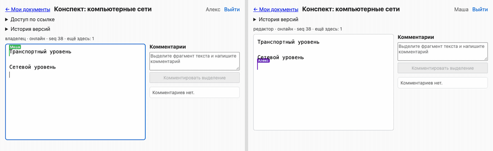
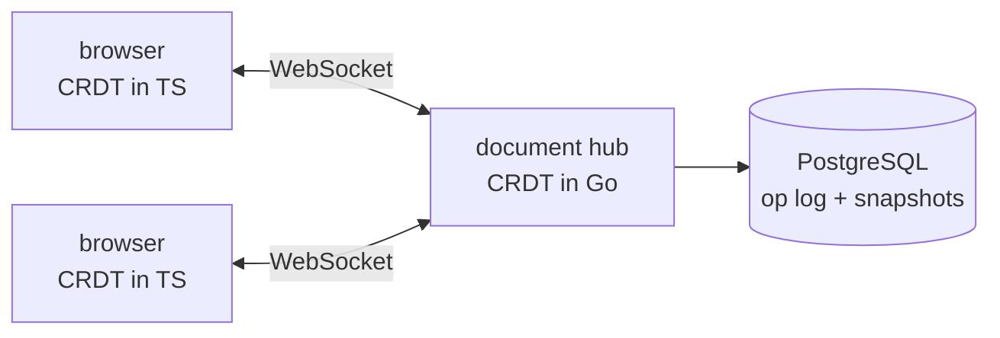

# Cloute

A collaborative text editor: several people edit one document in real time
and see each other's cursors.

[Русский](README.md) · **English**

<p align="center">
  
</p>

## Why

Google Docs is not always an option: it needs an account, the data lives with
another company, and there is no offline mode. Cloute runs on your own server
as a single binary, and concurrent and offline edits merge without conflicts
through a CRDT.

## Features

- real-time co-editing with everyone's cursors and selections
- offline mode: edits are kept locally and sent after reconnecting
- `owner` / `editor` / `commenter` / `viewer` roles and access links
- comments on text ranges that stay in place while the text changes
- version history and revert without losing other people's edits
- Prometheus metrics at `/metrics`

## How it works



The CRDT (RGA) is written by hand twice, in Go and in TypeScript. Both are
checked against the shared test vectors in `testdata/crdt/`. A client sends
operations over WebSocket; the document hub applies them, stores them in
Postgres and broadcasts them to everyone else.

## Stack

Go · PostgreSQL (pgx, goose) · WebSocket · TypeScript · Vite · Docker

## Structure

```
cmd/server/          entry point
internal/crdt/       CRDT in Go
internal/doc/        document hub: ops, broadcast, presence
internal/transport/  WebSocket
internal/httpapi/    REST: documents, links, versions
internal/storage/    PostgreSQL
internal/auth/       users, sessions, roles
web/                 TypeScript client
migrations/          SQL migrations
testdata/crdt/       shared CRDT test vectors
deploy/              Dockerfile and docker-compose
```

## Run

```bash
make db-up                 # PostgreSQL in Docker
npm --prefix web ci
make run                   # server on :8080
npm --prefix web run dev   # client on http://localhost:5173
```

One binary with the frontend embedded: `make build` → `bin/cloute`.
With Docker: `docker compose -f deploy/docker-compose.yml --profile app up -d --build`.

Tests: `go test ./...` and `npm --prefix web test`.

P.S. For now it runs locally on localhost.
