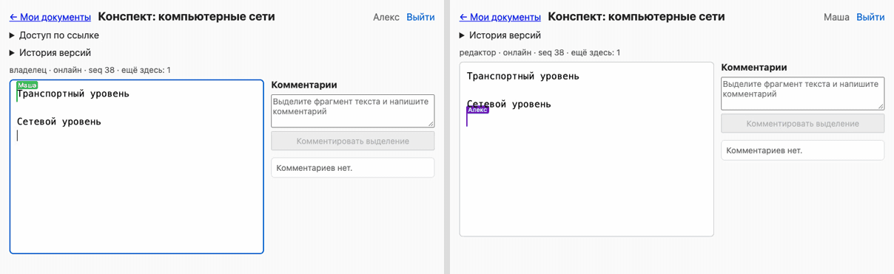
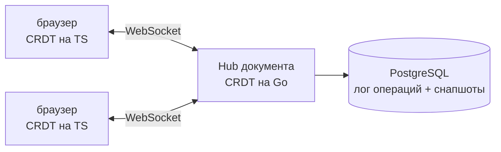

# Cloute

Совместный текстовый редактор: несколько человек правят один документ в
реальном времени и видят курсоры друг друга.

**Русский** · [English](README.en.md)

<p align="center">
  
</p>

## Зачем

Google Docs не всегда можно использовать: нужен аккаунт, данные лежат у чужой
компании, нет офлайна. Cloute ставится на свой сервер одним бинарником, а
одновременные и офлайн-правки сливаются без конфликтов через CRDT.

## Что умеет

- совместная правка в реальном времени, курсоры и выделения участников
- офлайн: правки копятся локально и досылаются после переподключения
- роли `owner` / `editor` / `commenter` / `viewer` и доступ по ссылке
- комментарии к фрагментам текста, которые не «съезжают» при правках
- история версий и откат без потери чужих правок
- метрики Prometheus на `/metrics`

## Как устроено



CRDT (RGA) написан вручную дважды, на Go и на TypeScript. Обе версии
проверяются на общих тест-векторах из `testdata/crdt/`. Клиент шлёт операции
по WebSocket, Hub документа применяет их, пишет в Postgres и рассылает
остальным.

## Стек

Go · PostgreSQL (pgx, goose) · WebSocket · TypeScript · Vite · Docker

## Структура

```
cmd/server/          точка входа
internal/crdt/       CRDT на Go
internal/doc/        Hub документа: операции, рассылка, присутствие
internal/transport/  WebSocket
internal/httpapi/    REST: документы, ссылки, версии
internal/storage/    PostgreSQL
internal/auth/       пользователи, сессии, роли
web/                 клиент на TypeScript
migrations/          SQL-миграции
testdata/crdt/       общие тест-векторы CRDT
deploy/              Dockerfile и docker-compose
```

## Запуск

```bash
make db-up                 # PostgreSQL в Docker
npm --prefix web ci
make run                   # сервер на :8080
npm --prefix web run dev   # клиент на http://localhost:5173
```

Одним бинарником с фронтендом внутри: `make build` → `bin/cloute`.
Через Docker: `docker compose -f deploy/docker-compose.yml --profile app up -d --build`.

Тесты: `go test ./...` и `npm --prefix web test`.

P.S. Пока запускается локально через localhost.
